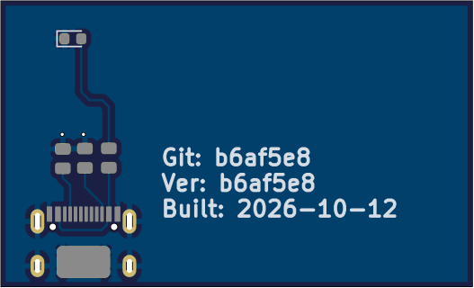
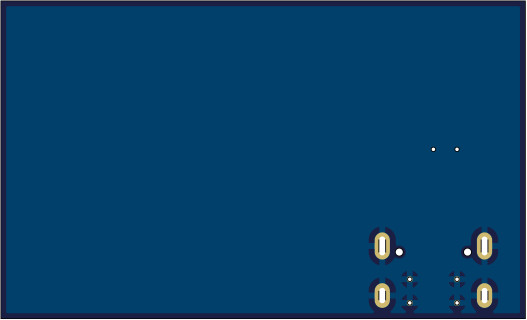
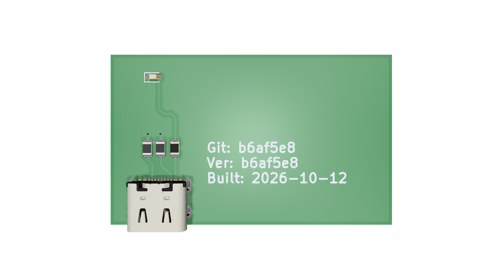
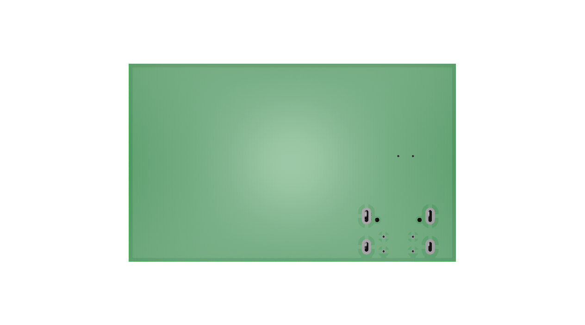

# project-mono-repo-ci-template

My starting point for hardware projects. KiCad boards and STM32 firmware live in the same repo, and GitHub Actions takes care of the boring parts: fabrication files, renders, BOMs, ERC/DRC, and firmware builds.

This README only exists on the template repo. New projects get the root [`README.md`](../README.md).

## What the CI does

**Hardware** (`hardware/**`, on PRs to `main` or run manually)

KiBot runs on every board that changed in the PR and generates:

- ERC/DRC reports
- schematic PDF
- Gerbers, drill files, pick-and-place, and assembly drawings
- BOM (csv/xlsx) and an interactive BOM
- 2D and 3D renders
- a KiBot results page for browsing everything

The outputs are committed back to the PR branch under `hardware/<board>/documentation/`. The renders and a fabrication badge are written into the project README between the `PCB_RENDERS` markers.

A board is any folder `hardware/<name>/` that contains `<name>.kicad_pro`. Boards build in parallel.

The KiBot config also sets `GIT_HASH`, `GIT_TAG` and `BUILD_DATE` text variables. Put them on the silkscreen and every board shows which commit it came from.

**Firmware** (`firmware/**`, on PRs to `main`)

Builds with CMake and arm-none-eabi-gcc using the stm32-cmake container, uploads `.elf`/`.hex`/`.bin` as artifacts, and runs cppcheck.

## Example

Output for the demo board `pcb_1`:


| Top | Bottom |
|-----|--------|
|  |  |
|  |  |

Generated files: [schematic](../hardware/pcb_1/documentation/schematic/pcb_1-schematic.pdf), [BOM](../hardware/pcb_1/documentation/bom/pcb_1-bom.csv), [gerbers](../hardware/pcb_1/documentation/fabrication/gerbers), [assembly](../hardware/pcb_1/documentation/fabrication/pcb_1-assembly.pdf), [checks](../hardware/pcb_1/documentation/checks).

## Layout

```
.github/workflows/   fw_ci.yaml, hw_fabrication.yaml
.kibot/kibot.yaml    shared KiBot config
firmware/            STM32 CMake project
hardware/
  block_diagram/     draw.io architecture diagram
  templates/         KiCad drawing sheet
  pcb_1/             one folder per board
    documentation/   generated by CI
README.md            project README
```

## Starting a new project

1. Use this template → Create a new repository
2. Delete `.github/README.md`
3. In `README.md`, set the title and replace `OWNER/REPO` in the badge URL
4. Rename `hardware/pcb_1` (folder name = `.kicad_pro` name) and delete its `documentation/` folder
5. Put the firmware in `firmware/`. CI expects `cmake/stm32_gcc.cmake`, `src/` and `include/`
6. Open a PR
